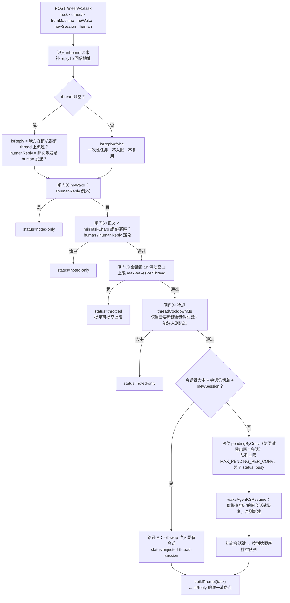

# Thread 多轮任务：机制、版本史与迭代记录

> **这份文件的位置与用途**：`thread` 多轮派发这块会持续迭代，所以把「机制怎么走、
> 哪个版本改了什么、现在是什么状态、已知缺陷和下一步」全部落在这里，**随代码旅行**。
> 不要把它留在某一台机器的 `~/.dsh/` 里 —— 那会在换机、重装、他人接手时直接蒸发。
>
> 维护约定见文末「变更日志」。任何一次改动都要在那一节追加一条，而不是改写历史。

---

## 0. 一页速览

| 项 | 现状 |
| --- | --- |
| 多轮复用链路 | **健康**：同 thread 的第二轮会正确复用第一轮那个会话 |
| 回执判定（`isReply`） | **有缺陷**：同 thread 上的第二、三轮新任务会被判成「回执」→ 提示词禁止回派 → 结果静默丢失 |
| 缺陷编号 | `D-001`（见第 5 节），**上游 main 仍未修**，自 0.5.19 之前就存在 |
| 影响面 | 只影响**提示词尾巴**，不影响路由、闸门、会话绑定 —— 所以系统看起来一切正常 |
| 为什么久未被发现 | `isReply` 在 UI 里根本不出现（`client/client.js` 中该字符串出现 0 次），错误没有任何界面表现 |

---

## 1. 术语：三个标识不是一回事

多轮任务的一半坑来自概念混淆，先把三件事分清：

| 标识 | 形状 | 决定什么 | 归谁所有 |
| --- | --- | --- | --- |
| `thread` | 自由字符串，如 `mesh-webpanel-deploy` | 哪些消息属于同一件事（**车道**，长期复用） | 发起方命名 |
| 会话键 `conversationKey` | `<机器名>#<sha256(机器名\0thread) 前 12 位>` | **本机**用哪个会话处理这条消息 | 每端各算 |
| 回信地址 `replyTarget` | `{machine, originSession, thread}` | 结果送回**对方**哪个会话 | 发送方 |

三条硬规则：

1. **会话键两端算出的值不同**（A 看到 `hos#xxx`，B 看到 `lipeng-mac#xxx`）。这不是 bug ——
   每端只需在**自己的**收件箱里唯一区分对话，要求两端算出同一个字符串反而要引入协商。
2. **回信地址不参与本机路由**。早期实现拿 `originSession` 去本机找会话（"路径 B"），
   那个分支永远返回 `false`，是纯设计错误，已删除。它只是"结果寄给谁"。
3. **`thread` 是绑定到单个发起会话的**：发起侧会把这个 thread 绑到自己的 `originSession`，
   另一个会话复用同名 thread 会被直接拒绝（"thread 已绑定另一会话，请使用新的 thread"）。

---

## 2. 机制：一条入站消息走完的全程



要点：

- **闸门只回答"值不值得开跑"**，不回答"这条是什么性质"。四条闸门的判定全部留痕在
  `routeDecision` 里，这是排查多轮问题的第一现场。
- **能注入就跳过冷却**：注入既有会话是便宜的，冷却要防的"建会话风暴"已由
  `pendingByConv` 排队锁接管。
- **`isReply` 在闸门之前算出，但只在最后一步拼提示词时被读到**。这点决定了 D-001 的
  危害形态：路由全对，只有"做完要不要回派"这条指令错了。

### 状态字全表（对账用）

| status | 含义 | 带原因？ |
| --- | --- | --- |
| `dispatched` | 新建/恢复了会话并开跑 | `routeDecision` 写明新建还是恢复 |
| `injected-thread-session` | 复用同 thread 会话 | 同上，含会话键 |
| `injected-queued` | 排队后被注入 | 同上 |
| `noted-only` | 未唤醒（noWake / 太短 / 寒暄 / 冷却） | 是（"未唤醒：原因"） |
| `throttled` | 撞滑动窗口上限 | 是，带释放倒计时 |
| `busy` | 同键积压超上限 | 是（明确回忙，不假装受理） |
| `stored-only` | 唤醒能力不可用 | 是（`dispatchError`） |
| `queued-lost` / `dispatch-failed` | 注入失败 / 建会话失败 | 是 |

### 落盘账本

`~/.dsh/mesh/threads.json`：

- `threads[<会话键>] = { sessionId, wakesAt[] }` —— 本机用哪个会话处理该键、窗口内唤醒时间点。
- `capOverrides[<会话键>]` —— 人工提高过的上限（滑动窗口，不是终身配额）。
- 发起侧还会把该键绑到自己的 `originSession`，用于"thread 已被别的会话占用"的拦截。

---

## 3. 版本史

> **纪律**：备份目录名**不可信**，一律以目录内 `package.json` 的 `version` 为准。
> 已实测到目录名与实际内容不符（如 `dsh-plugin-mesh.bak-0.5.13-*` 里装的是 **0.5.12**）。

| 时间 | 版本 | 证据（本仓库之外的本机实物） | 备注 |
| --- | --- | --- | --- |
| 2026-10-21 | — | 分支 `fix/pr30-followups`，commit `4caf0c4` "fix: 回执被当成新任务 → 两边互相回执形成循环" | **`isReply` 机制的诞生点**，起因是互刷几十条的真机事故 |
| 2026-10-22 | — | 本机若干克隆停在 `fix/pr30-followups` | 之后该分支并入主线 |
| 2026-10-31 | 0.5.7 | `~/mesh-backup-0.5.7.tar.gz`；`node_modules/dsh-plugin-mesh.bak-20261031-143127.tgz`（md5 `51dcceb0cafe50c46819caf57451abee`） | 整包备份 |
| — | 0.5.8 | `.mesh-upgrade-backup-0.5.8-1793979973486/` | 升级器自动留的备份 |
| — | 0.5.12 | `dsh-plugin-mesh.bak-0.5.13-20261110-172917/`（目录名写成 0.5.13，实为 0.5.12） | 命名不可信的第一个实例 |
| — | 0.5.14 | `.mesh-upgrade-backup-0.5.14-1794485213503/` | |
| — | 0.5.15 | `dsh-plugin-mesh.bak-0.5.16/`（目录名写成 0.5.16，实为 0.5.15） | 第二个实例 |
| 2026-11-14 | 0.5.16 | `dsh-plugin-mesh.bak-0.5.16-20261114-013730/` | |
| — | 0.5.18 | `.mesh-upgrade-backup-0.5.18-1794732965763/` | |
| 2026-11-15 16:56 | **0.5.19** | `node_modules/dsh-plugin-mesh/`（当前安装） | 服务端代码基线 |
| 2026-11-15 22:55 | 客户端 = main | `client/client.js` md5 `02fe9782b017deebb9daf409be701d14`，来源 `192.168.1.5:8799/mesh-client-0dcf63f5e2c0b2a3.js`；备份 `client.js.bak-webhost-20261115-225554`（md5 `f74dc474700c293c1b1f72f2e92ca6bb`） | client-only 修复：面板搬出 MeshApp、空闲销毁、可见期心跳 |
| 2026-11-15 22:57 | 引擎重启 | 日志 `~/tmp/dsh-engine-restart.log`：`SIGTERM 12741 → 新引擎 1095`（8s） | 宿主启动时才读 bundle，刷新页面不够 |
| 2026-11-15 23:00 | 前端重载 | 设置 → 开发者选项 → 刷新界面 | 引擎未重启（pid 不变） |
| 2026-11-15 | **0.5.20**（main `34a3372`） | `chore(release): v0.5.20 [skip ci]` | 与装机的 0.5.19 相比 **`lib/index.js` 只差 `VERSION` 字面量**；`prompt.js`/`conversation.js`/`client.js` 逐字节相同 |

### 由此得到的一个结论

**本机处于"服务端 0.5.19 + 客户端 0.5.20-main"的混合态**，但两者内容等价
（服务端仅版本常量不同，客户端 md5 与 main 完全一致）。所以在 D-001 上，
"装机表现"与"上游 main 表现"可以互相引用，不需要怀疑是版本错位导致的。

---

## 4. 现状快照

> 采集时间：2026-11-16 00:32 CST（本机 `hos`，Android 壳 `com.dsharnessmobile.shell`）

| 项 | 值 |
| --- | --- |
| 插件版本 | 0.5.19（`node_modules/dsh-plugin-mesh/package.json`） |
| `lib/index.js` | `7f79206d273f2df32cb3884b4580c421` |
| `lib/prompt.js` | `c4ec76087cb63ea8fddccd8fd9a8e184` |
| `lib/conversation.js` | `e7d11779d8ea8b2a493d27be6716ec63` |
| `client/client.js` | `02fe9782b017deebb9daf409be701d14`（= 上游 main） |
| 引擎 | pid `1095`，`bin.js web --port 3080`，22:57:16 起 |
| mesh 服务端口 | `45917`（`MESH_DEFAULT_PORT`），本机名 `hos` |
| 线程账本 | `~/.dsh/mesh/threads.json`，当前 6 条键；`capOverrides` 为空 |
| 已知缺陷 | `D-001` 未修（上游 main 同样未修） |

---

## 5. 缺陷登记

### D-001：同 thread 的第 2..n 轮新任务被判成「回执」

**位置**：`lib/index.js` → `handleInboundTask()` → `task.isReply = (outbound ?? []).some(sameThread)`
（`sameThread` 判据 = `toMachine === 发送方 && thread 相同`），消费点在 `lib/prompt.js`。

**判据错在哪一层**：`thread` 是**车道**（长期复用、官方推荐复用），回执是**单条消息的语用**。
用"车道上跑过我方的车"推断"这一辆是回来的"——第 2..n 轮必然命中。

**实测数据**（`GET /mesh/v1/tasks`，本机 2026-11-15）：

| 任务 | thread | 内容性质 | `isReply` | 提示词尾巴 |
| --- | --- | --- | --- | --- |
| `t-be6dcb944cf2` | `mesh-webpanel-deploy` | 第 1 轮真任务 | `false` ✅ | 「做完后回派」 |
| `t-0b1b230d846a` | `mesh-webpanel-deploy` | 第 2 轮真任务（2 个编号步骤） | **`true`** ❌ | 「这是回执…不要回派」 |
| `t-d3b28944c210` | `t-fence-reapply-skill` | 第 1 轮真任务 | `false` ✅ | 「做完后回派」 |
| `t-3216323b5a8b` | `t-fence-reapply-skill` | 第 2 轮真任务 | **`true`** ❌ | 「这是回执…不要回派」 |

两条 thread、两条二轮任务，**100% 误判**。

**危害形态**：提示词里给的是**禁令**，所以错误方向是**静默** —— 请求方永远等不到结果，
既没有报错也没有界面信号。`humanReply` 兜底也救不到：agent 之间互派的 `human` 为
`false`（只有聊天窗口 `@` 与面板手动派发才置 `human: true`）。

**复现**（任一台已装 mesh 的机器）：

```bash
curl -s http://127.0.0.1:45917/mesh/v1/tasks | node -e '
let d="";process.stdin.on("data",c=>d+=c).on("end",()=>{
  for (const t of JSON.parse(d).tasks)
    console.log(t.id, "isReply="+t.isReply, "|", String(t.thread), "|", String(t.task).slice(0,40));
})'
```

判读：同一 `thread` 上出现第二条 `isReply=true` 且正文是工作型内容，即命中 D-001。

**顺序法修不掉**：时间线本身就是 `我方派发 → 对方回来一条`，从时序看二轮任务与真回执
完全同形。差别只在**意图**，所以判据必须由发送方声明。

---

## 6. 迭代计划

| 编号 | 优先级 | 内容 | 涉及文件 | 验收标准 |
| --- | --- | --- | --- | --- |
| P0 | 止血 | 「回执」模板从**禁令**改成**条件式**：只是确认就转述；含新的工作要求就做完并回派一次（结果不带 `noWake`） | `lib/prompt.js` | 同 thread 第二轮任务的提示词中不再出现"不要再用 mesh_run 回派"；真回执场景仍不鼓励回派 |
| P1 | 治本 | `mesh_run` 增加发送方声明（`expectReply: boolean` 或 `kind: "task"｜"ack"`），随 payload 传输；接收端**声明优先**，启发式降级为没有声明时的兜底 | `lib/index.js`（工具入参 + payload + `handleInboundTask`）、`lib/prompt.js` | 三态（声明要回/声明不回/老对端未声明）各有单测 |
| P2 | 防回归 | 判据要单测。现有 `_selftest-prompt.mjs` 只覆盖模板文案，没有覆盖"同 thread 第二轮不得判成回执" | `lib/_selftest-prompt.mjs`、`lib/_selftest-reply-route.mjs` | `npm run selftest:prompt` 能拦住 D-001 的回归 |
| P3 | 观察项 | 滑动窗口上限按**会话键**记账，而多轮任务共用同一键 —— 长对话会自己撞 30/h 上限 | `lib/index.js` | 决定是"按 thread 记账"还是"多轮场景提高默认值"，需实测数据支撑 |
| P4 | 一致性 | `minTaskChars` 的 zod 默认是 8，但 `classifyInbound` 里写了 `?? 24` 兜底，配置缺失时行为跳变 | `lib/index.js` | 两处收敛为同一个来源 |
| P5 | 可观测性 | 让"这条被判成回执"在界面或诊断里可见（至少 Mesh 面板任务列表能标出来） | `client/client.js`、`lib/index.js` | 误导判能在 UI 上一眼看出，不靠翻 `/mesh/v1/tasks` |

**发布链路注意**：两边都要改才成立（协议层，单边改等于半修）。提交信息决定版本号，
`fix:` → patch，`docs:` → patch，见 [`CONTRIBUTING.md`](../CONTRIBUTING.md)。

---

## 7. 决策记录

| 编号 | 决策 | 理由 |
| --- | --- | --- |
| ADR-001 | **保留** `isReply` 这个机制，只换判据 | 2026-10-21 的互刷事故（`4caf0c4`）是真的，目标没错；错的是用 thread 历史推断单条消息语用 |
| ADR-002 | 不在 `node_modules/` 里直接改 | 升级必覆盖（本机已有多次实例）。要么走上游，要么按 `dsh-fence-reapply` 的先例做成"升级后重打"的补丁器 |
| ADR-003 | 两边都改，不接受单边修 | 提示词由**接收方**生成，而意图只有**发送方**知道；只改一边必然有一半场景仍然错 |
| ADR-004 | 这份文档进仓库，而不是留在机器上 | 换机/重装/他人接手时 `~/.dsh/` 会蒸发；版本史与缺陷登记必须随代码旅行 |
| ADR-005 | 错误方向的取舍：宁可"多回派一次" | 多回派是**可见的噪音**（可被日志和上限发现），错误禁止回派是**静默的丢失**。排障成本差一个量级 |

---

## 8. 观测与复现命令

```bash
# 本机收件箱（含 isReply / routeDecision / replyTo）
curl -s http://127.0.0.1:45917/mesh/v1/tasks | node -e 'let d="";process.stdin.on("data",c=>d+=c).on("end",()=>console.log(JSON.parse(d).tasks.slice(0,5)))'

# 线程账本（谁绑了哪个会话、窗口内唤醒几次）
cat ~/.dsh/mesh/threads.json

# 回执模板与判据的自测
npm run selftest:prompt
npm run selftest:reply
```

判读口诀：**先看 `routeDecision` 路由对不对，再看提示词尾巴对不对**。D-001 的特征是
"路由正确、尾巴错误"，两者同时出错才是别的问题。

---

## 9. 变更日志

> 追加，不改写。格式：`日期 | 版本/分支 | 谁改的 | 改了什么 | 依据`

| 日期 | 版本/分支 | 变更 | 依据 |
| --- | --- | --- | --- |
| 2026-10-21 | `fix/pr30-followups` `4caf0c4` | 引入 `isReply`：同 thread 上我方派过的入站消息按回执处理 | 互刷几十条的真机事故 |
| 2026-11-15 22:55 | 客户端 = main | `client/client.js` 替换（面板搬出 MeshApp、空闲销毁、可见期心跳） | 对端（Mac）派发的部署任务 |
| 2026-11-15 22:57 | 引擎 pid 1095 | 重启生效 | client bundle 由宿主启动时载入 |
| 2026-11-15 23:00 | — | 前端「刷新界面」重载 | 客户端 JS 常驻内存，需重载 |
| 2026-11-15 | — | 登记 D-001，实测 4 条任务 100% 复现；产出本文件 | `GET /mesh/v1/tasks` 现场数据 |
| 2026-11-16 | `docs/thread-multi-round-log` | 新建本文件：机制、版本史、现状、D-001、迭代计划 P0–P5 | 复盘 thread 多轮任务逻辑 |
